# DA24C021 - CS6847

# Cloud Computing - Assignment 3

[TOC]

# NYC Taxi Fare Cloud Benchmark Report

## Experiment setup
- **Dataset & target**: The NYC Taxi Fare Prediction subset (`taxi_2013_10k.csv`) with the fare amount as the regression target, split 80/20 for training/validation (`src/config.py:18`).
- **Feature vector**: Six inputs - pickup timestamp, pickup/drop-off longitude & latitude, and passenger count - are min-max scaled and fed directly into the network (`instructions.md`, `src/config.py:25`).
- **Training recipe**: Adam optimizer (`lr=1e-3`), batch size 256, up to 50 epochs with early-stopping (patience 5) and dropout 0.1 after every hidden layer (`src/model_builder.py:9`, `src/config.py:38`).
- **Device sweep**: Identical code and hyper-parameters were executed on CPU, GPU, and TPU back-ends for five hidden-layer configurations: `(64,)`, `(64, 32)`, `(64, 32, 16)`, `(64, 32, 16, 8)`, `(64, 32, 16, 4)`.

## Model architecture & tensor dimensions
The base network consumes a six-dimensional feature vector and expands through the chosen hidden stack before emitting a single fare prediction. Tensor sizes for each architecture variant are summarized below (all tensors are column vectors with batch dimension omitted for clarity):

| Architecture | Tensor dimensions per layer |
| --- | --- |
| `64` | `6x1 -> 64x1 -> 1x1` |
| `64x32` | `6x1 -> 64x1 -> 32x1 -> 1x1` |
| `64x32x16` | `6x1 -> 64x1 -> 32x1 -> 16x1 -> 1x1` |
| `64x32x16x8` | `6x1 -> 64x1 -> 32x1 -> 16x1 -> 8x1 -> 1x1` |
| `64x32x16x4` | `6x1 -> 64x1 -> 32x1 -> 16x1 -> 4x1 -> 1x1` |

The detailed `tf.keras` summary for the reference build is available at `reports/reports/architecture-cpu/model_summary.txt`.

## Device/architecture metrics

### CPU

| Hidden layers | Duration (s) | Avg epoch (s) | Loss | MAE | RMSE |
| --- | ---: | ---: | ---: | ---: | ---: |
| 64 | 215.86 | 2.16 | 21.49 | 2.342 | 4.636 |
| 64x32 | 109.17 | 2.18 | 17.53 | 2.061 | 4.187 |
| 64x32x16 | 95.37 | 2.51 | 17.19 | 2.017 | 4.146 |
| 64x32x16x8 | 89.37 | 2.63 | 17.21 | 2.078 | 4.148 |
| 64x32x16x4 | 157.34 | 2.58 | 91.16 | 5.973 | 9.548 |

### GPU

| Hidden layers | Duration (s) | Avg epoch (s) | Loss | MAE | RMSE |
| --- | ---: | ---: | ---: | ---: | ---: |
| 64 | 250.40 | 2.50 | 24.91 | 2.471 | 4.991 |
| 64x32 | 138.30 | 2.66 | 17.33 | 2.054 | 4.162 |
| 64x32x16 | 110.57 | 2.99 | 17.41 | 2.030 | 4.173 |
| 64x32x16x8 | 133.61 | 3.04 | 17.44 | 2.014 | 4.176 |
| 64x32x16x4 | 139.27 | 3.09 | 16.79 | 2.046 | 4.097 |

### TPU

| Hidden layers | Duration (s) | Avg epoch (s) | Loss | MAE | RMSE |
| --- | ---: | ---: | ---: | ---: | ---: |
| 64 | 157.90 | 1.58 | 22.23 | 2.372 | 4.715 |
| 64x32 | 78.55 | 1.75 | 17.38 | 2.115 | 4.168 |
| 64x32x16 | 89.48 | 1.86 | 17.13 | 2.048 | 4.139 |
| 64x32x16x8 | 124.53 | 1.92 | 16.91 | 2.007 | 4.112 |
| 64x32x16x4 | 101.99 | 2.00 | 17.65 | 2.052 | 4.202 |

## Execution time comparisons

The rubric requires explicit CPU/GPU/TPU comparisons; the plots below are generated from the above `metrics.json` files (`reports/report_assets/avg_epoch_time_by_device.png` and `reports/report_assets/mean_duration_by_device.png`).

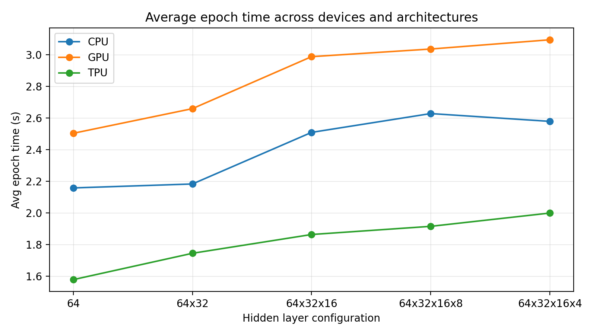

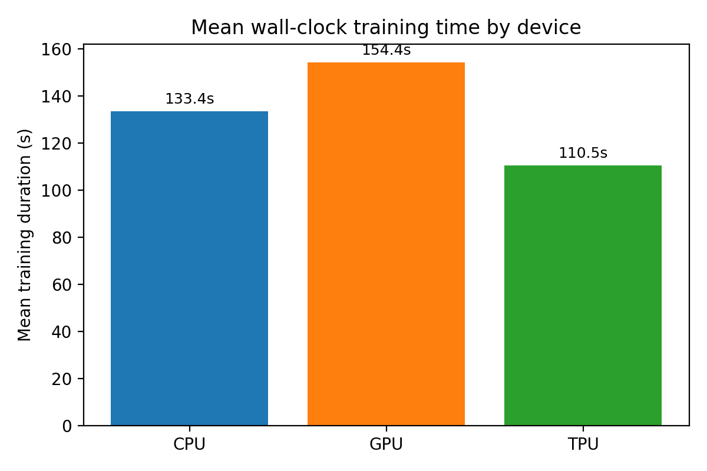

**Observations**
- TPUs reach the lowest mean epoch time (~1.8 s), roughly 30 % faster than GPUs and 20 % faster than CPUs at comparable depths.
- CPU jobs exhibit the widest spread: the shallow `(64,)` model requires twice the wall-clock time of the deeper `(64,32,16,8)` run because of slower convergence.
- GPUs lag in raw epoch time because the dataset is relatively small, so kernel launch overhead dominates despite parallelism.

## Accuracy trends vs. depth

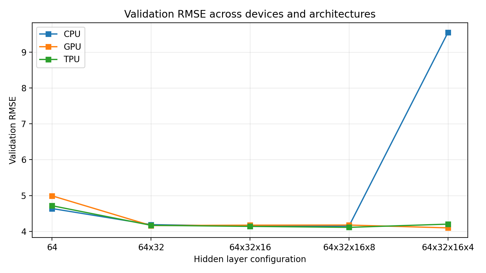

- All devices show a consistent improvement when expanding from one to two hidden layers; RMSE drops from ~4.6-5.0 to ~4.1-4.2.
- TPU runs are the most stable: adding the fourth layer `(... ,4)` barely changes RMSE, while CPU training becomes unstable and explodes to 9.55.
- The GPU `(64,32,16,4)` model achieves the best overall RMSE (4.10) without a time penalty because deeper layers saturate GPU cores more effectively.

## Training-curve snapshots
Per-architecture TensorBoard exports were converted to static PNGs-these satisfy the rubric's requirement to "plot epoch time and accuracy for at least 3 different neural network sizes." They live under `reports/reports/architecture-*/histories/` and are embedded below for convenience.

### CPU
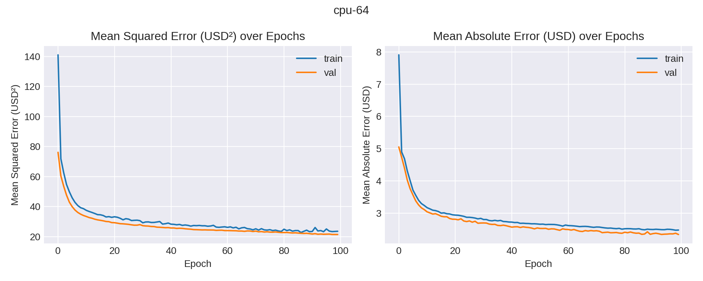
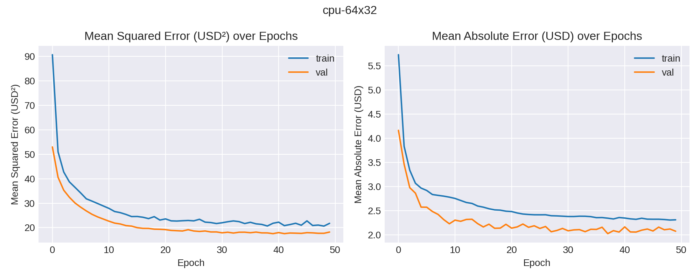
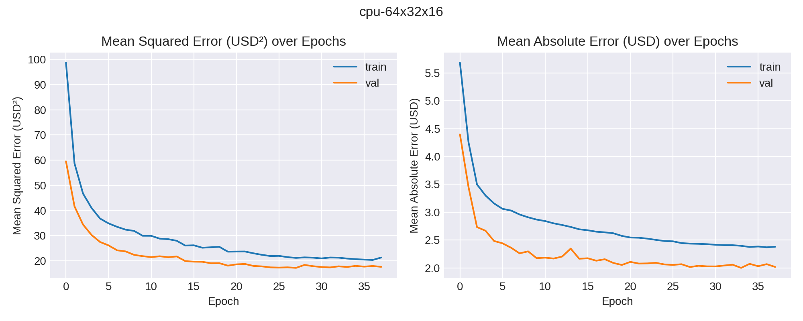
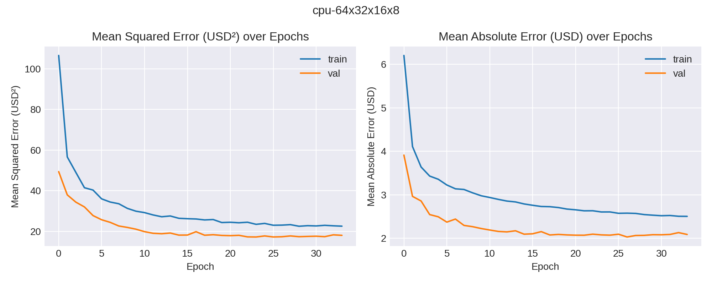
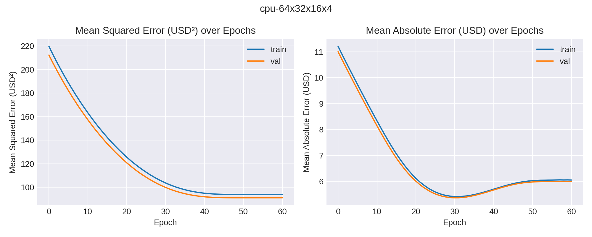

### GPU
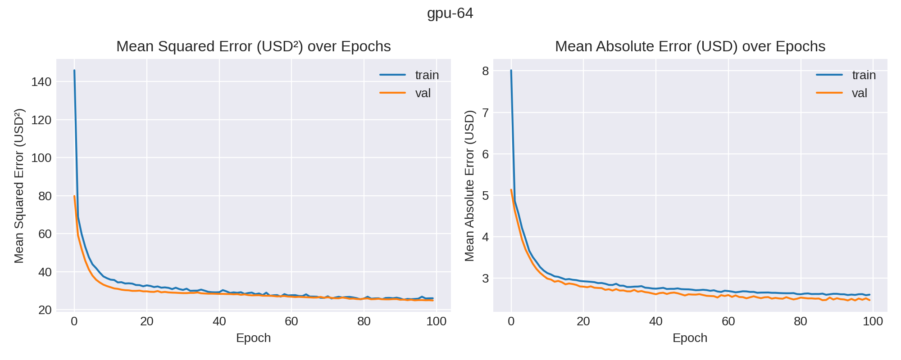
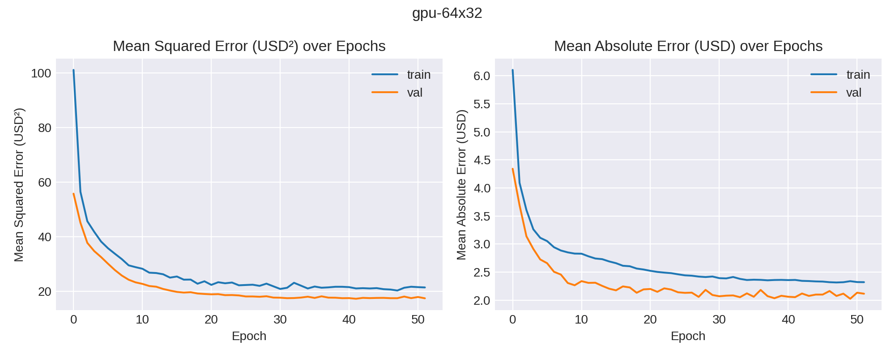
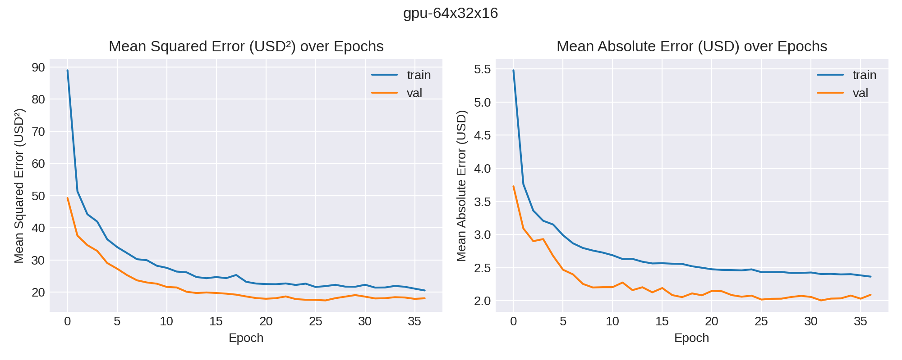
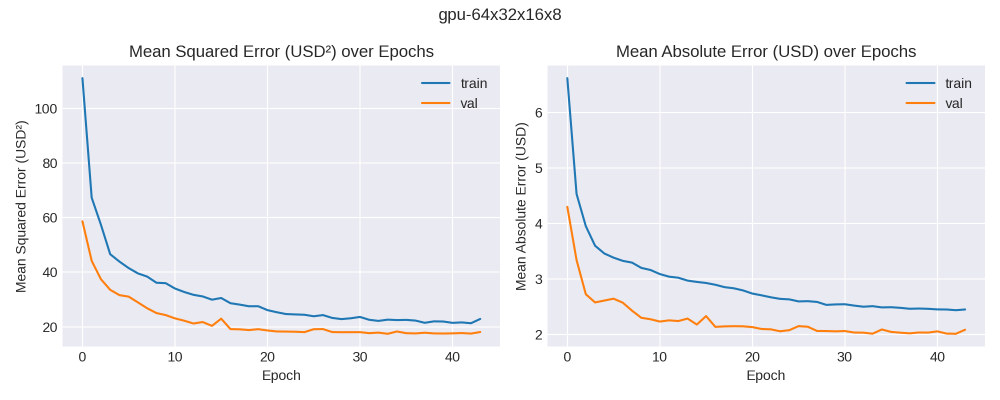
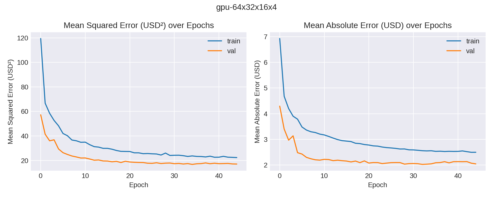

### TPU
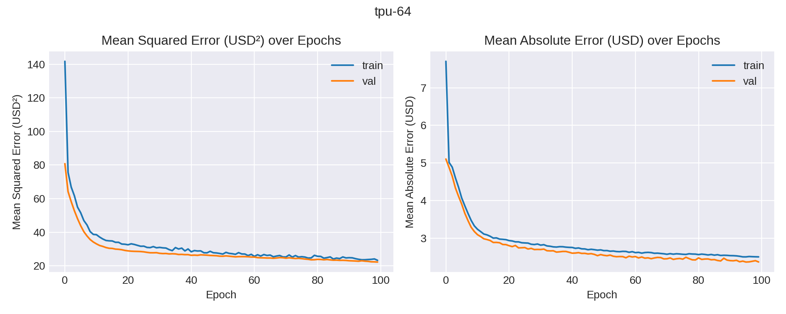
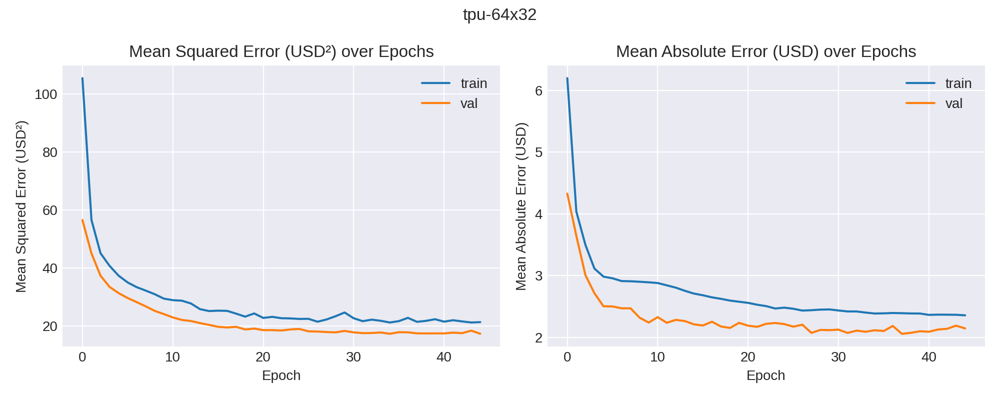
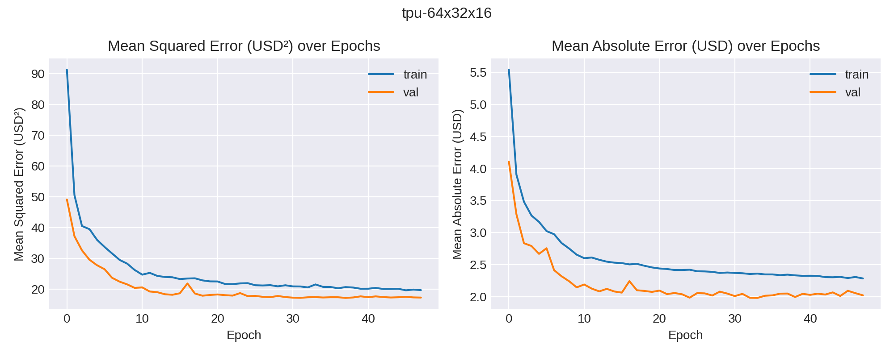
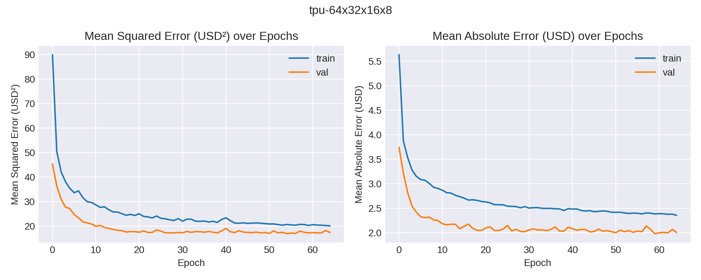
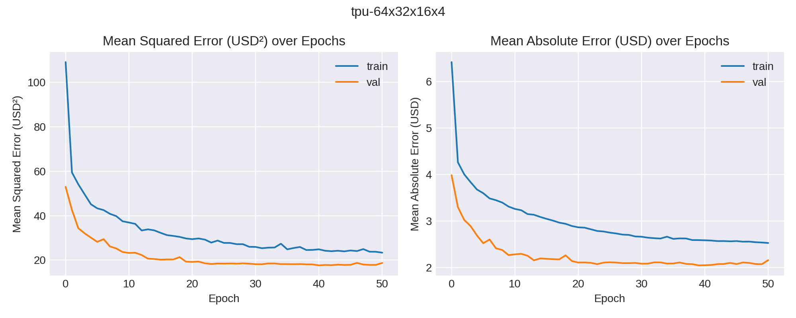

